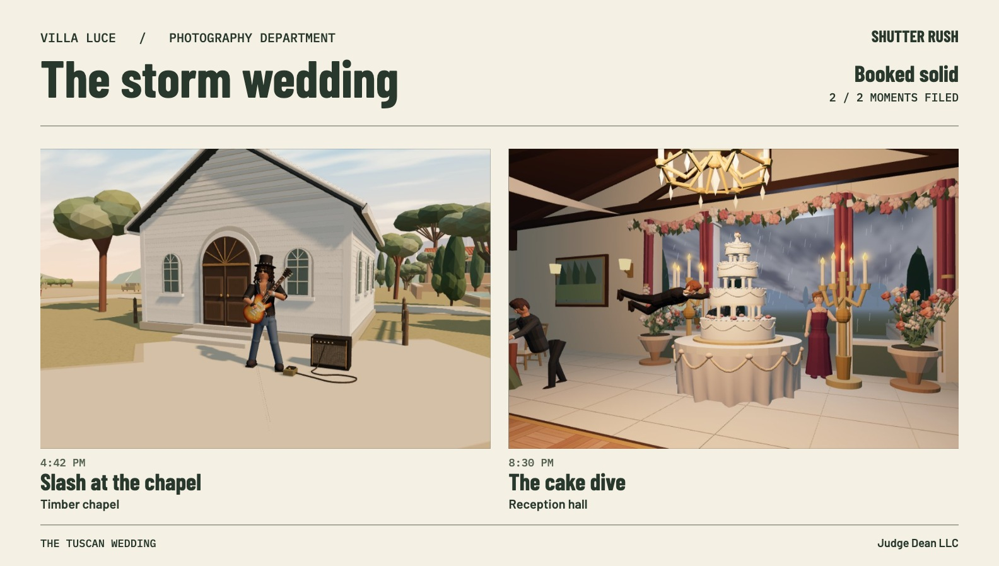

# Shutter Rush

A first-person wedding photography game by Judge Dean LLC. Race a golf cart across Villa Luce, swap lenses on the run, and get the shot before the moment passes.



## Choose an assignment

| Assignment | Time | What to shoot |
| --- | --- | --- |
| Full wedding | 12 minutes | Follow 33 photo calls across 13 locations, from the invitation to the getaway car. |
| Storm wedding | 65 seconds | Photograph a chapel guitar solo, then race to the reception for the cake dive. |
| Bouquet rewind | Two 30-second takes | Shoot the toss, rewind, and frame a second angle while your first self replays. |

## Run locally

From the repository root, start the static server with Python 3.

```sh
python3 -m http.server 8000 --directory dist
```

Open [the game](http://localhost:8000/) or [the Storm Wedding assignment](http://localhost:8000/?assignment=storm) in a browser with WebGL 2. Sound starts when you enter an assignment.

To host the game, serve the contents of `dist/` with `index.html` at the site root. Three.js, cannon-es, fonts, and audio are bundled. The library and font notices are in [dist/vendor](dist/vendor/) and [dist/fonts](dist/fonts/).

## Play

Select **Play full wedding · 12 min** to cover 9 AM to midnight. The itinerary has 32 commissioned photos and one bonus across 13 locations. Start in the bridal suite with the invitation flat lay. Cover wardrobe, the first look, wedding party, letters, arrivals, ceremony, family portraits, cocktails, dinner, dancing and the send-off.

Select **Storm wedding · 65 sec** for a two-photo assignment. Start outside the white timber chapel and photograph Slash playing an original electric-guitar solo. Then follow the pin to the cake salon in the reception hall. The rain arrives just before a guest dives into the tiered wedding cake. The album pairs your best photo from each call. Both scenes also play during the full wedding day.

The chapel solo and storm reception draw on the wedding sequences in the [official *November Rain* video](https://www.youtube.com/watch?v=8SbUC-UaAxE).

Sound starts when you enter a shoot. Turn toward the chapel to locate the amplifier by ear. Under cover, listen for rain on the roof and the sounds of the reception. Footsteps follow the ground under each shoe, including gravel paths, turf, rugs, stone terraces and timber floors. Exposed ground picks up wet footfalls in the storm. Each camera body has its own recorded shutter. In bouquet replay, your first photographer’s clicks and footsteps come from their recorded position. [Field recording credits](dist/sound/FIELD-RECORDINGS.md) Use the speaker button to mute or unmute.

The minimap shows your position and heading. The orange drop pin pings the next job when you file a keeper or a deadline passes. Follow the route around walls, furnishings and the lake. A second pin appears when the bonus dance opens during the bouquet toss. Press **M** or tap the minimap to pause and unfold the estate map. Select a landmark to see its assignments and which pages you have filed. Press **M** or choose **Back to camera** to resume.

The photographer’s golf cart is parked outside the bridal suite’s east door. Walk up beside it and press **E** to board. Hold **W** to accelerate, **S** to brake and reverse, and **A/D** to steer. The arrow keys also drive. Hold **Space** for a quicker stop. The map draws a driving route to an outdoor drop-off. Press **E** to park immediately and step out with the current camera ready. The route switches back to the subject. The parked cart stays marked so you can find it after the shot. The wedding clock keeps running during both transfers.

Loose wedding props react to contact. Walk into a folding chair, or look at a nearby prop and press **G** (tap **Nudge** on touch screens). A harder cart impact can shatter fragile decorations. Fallen props and fragments stay in the scene and in your photos for that run.

The live brief describes what must be in the photo. Wait for the peak and keep a clear view of the subject. The tablet uncle commits to a spot during the kiss, so sidestepping can clear the shot. Each page keeps your best manual exposure and earns up to 100 points. Improving a shot earns the difference. File all 32 commissions plus the disco bonus to earn **Wedding legend**. When the assignment ends, you can download your album, including pages for any missed moments.

Select **Bouquet rewind · 2 takes** for two 30-second takes. The bride releases the bouquet at 21 seconds and Grandma catches it at 23.5. First, work the garden with the wide-angle body. At 30 seconds the scene rewinds. Your second photographer starts inside the reception hall with the telephoto. Walk or switch cameras freely. Through the open doors you can see the first photographer retrace your movements and press the shutter at the original times. Loose props rewind too. Your first photographer can bump them again while you shoot the second angle.

The final sheet shows a photo from each take side by side, favoring shots of the airborne bouquet. Browse the available frames independently and select **Save photo pair** to download the two angles together. If you never press the shutter in a take, the game tries to save a clearly labeled safety frame through the active camera.

Move the mouse over the game to turn, on foot or at the wheel. Left-click for the shutter and right-click for the viewfinder. If the browser keeps the pointer visible, resting it near an edge continues the turn.

Use the 85–200 mm telephoto to pick a face out of the crowd, or draw the 24 mm wide-angle camera for a group shot. Each body carries its own battery and SD card. The frame corners show what the lens will capture, even with the camera lowered. Raising the viewfinder enlarges that composition. Rotate either camera for a vertical photo, crouch for a lower angle, or lean to peer past a guest.

| Action | Desktop control |
| --- | --- |
| Walk and look | WASD to walk. Move the mouse to look, or use the arrow keys |
| Shoot a burst | Hold left mouse or Space |
| Raise the viewfinder | Hold right mouse or F |
| Switch cameras | Q, or 1 for wide and 2 for telephoto |
| Zoom the telephoto | Scroll up / down or press + / − |
| Rotate landscape / portrait | V |
| Crouch / sprint | Hold C / Shift |
| Nudge a loose prop | G |
| Lean left / right | Hold Z / X |
| Swap card / battery on the active body | R / B |
| Board or jump out of the golf cart | E |
| Drive / steer / brake | W and S / A and D / Space |
| Estate map / pause / contact sheet | M / P / Tab |

On touch screens, push the joystick gently to walk or to its edge to sprint, drag the scene to look, and tap Camera, Rotate, or Crouch. Hold Shoot for a burst. Tap Aim to bring the camera’s eyepiece to your eye. Use the − and + buttons on the telephoto to adjust its focal length. In the cart, use the joystick for throttle and steering, hold **Brake** to stop, and tap **Jump out** to shoot. The 24 mm camera has a fixed wide-angle lens. Across the estate, a breeze moves tree crowns, flower stems, curtains, and the bride’s veil. It also ripples the pool and lake. The game respects your device’s reduced-motion preference for the breeze and camera movement.

The contact sheet keeps the latest 24 photos and your wedding-day keepers. In bouquet rewind, new faces and airborne bouquet shots earn extra points. Select a frame to view the camera and orientation used or download the JPEG.

Press R or B at any point during play to swap the active camera’s SD card or battery. Watch the side card door or bottom battery bay, then the harness pouch. The supply reading goes blank while its slot is empty, and the shutter becomes available when the camera returns to its ready position.

The couple has requested a cover photograph showing them together. Open a frame in the contact sheet and choose **Use as album cover** to see your print. You can change your selection during the assignment and download the cover as a JPEG before starting a new wedding.
